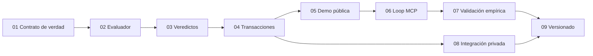

# Plan maestro — demostrar que `felix_felicis` funciona

El objetivo no es completar toda la visión antes de recibir evidencia. El
objetivo es demostrar, por capas, que Felix representa conocimiento sin
pérdida, detecta contradicciones formales, explica sus rechazos y mejora el
resultado de un agente en escenarios reproducibles.

## Estado global

| Campo | Valor |
|---|---|
| Estado | en curso |
| Versión de partida | `v0.1.0` |
| Próximo gate | `v0.2.0` |
| Progreso | 4/9 fases completas; fase 04 sigue en curso. U0–U4 y U6 están cerradas en sus límites; U5, U7 y U8 conservan avance parcial. CI `38512944346` pasó para `5c11f76`: Linux 727 passed/0 failed/6 ignored, Windows 719/0/6, 38 resúmenes de suites, tools 7/OS, fmt, clippy y frontera pública; añade cuatro pruebas de recovery. La matriz local workspace Windows 701/6 y WSL 709/6 pertenece al antecedente `609936a`, que no tiene CI remoto propio. CI `38232932504` es histórico para `a082467`; CI `38240021138` pasó solo para `701de13`, `38242930608` para SHA `db71e3c` con el runner `RestoreOld` previo, y `38246129604` solo para `a4d01e5`; esos runs no acreditan `609936a`. |
| Foco actual | Fase 04, Unidad 7: journal, commit y recovery. El dispatcher crate-private enruta `KeepOld`, `RestoreOld` y `DiscardNewRestoreOld`. `KeepOld` limpia stage `New`/`PartialNew` en su fila exacta; `RestoreOld` acepta stage `Absent`/`New`/`PartialNew` con root ausente y backup old en `Prepared`/`BackupReady`/`Installed`; `DiscardNewRestoreOld` solo acepta root `New`, backup `Old` y stage `Absent` en `BackupReady` (validación false/true) o `Installed` (false). Ambas limpiezas reobservan, conservan journal si queda stage parcial y permiten retry por identidad durable; root `New` con stage sibling presente falla cerrado. Desde `5c11f76`, `PartialOld` solo observa el backup con identidad de `old`, digest distinto y `old`/`new` IDs distintas; identidad de backup distinta o IDs old/new iguales quedan `Unknown`. `PartialOld` en root, backup o stage produce `FailClosed`/`NO_STEPS`, sin capacidad de recovery, cleanup, paso del runner ni orden nuevo. La limpieza del backup `PartialOld` se pospone por falta de frontera segura frente a cruce mount/bind/FUSE; es un bloqueo de diseño, no algo probado por el commit. No hay caller desde apply/producción; `KeepValidated`, `Committed` y recovery completo siguen pendientes. Los retries descritos como reinicio sueltan y readquieren el lock en el mismo proceso; no prueban kill/restart ni crash durability. La auditoría de prerequisitos de 2026-10-14 no cambia este estado parcial; su secuencia y límites están en «Próximo paso». |
| Última actualización | 2026-10-14 |

Estados admitidos: `pendiente`, `en curso`, `bloqueado`, `completo`. Una fase
solo pasa a `completo` cuando cumple todos sus criterios de aceptación y deja
evidencia reproducible en su registro.

## Qué significa «funciona»

| Afirmación | Evidencia requerida |
|---|---|
| La representación es fiel | Carga, serialización y recarga conservan átomos y anexos. |
| El check es correcto | Un evaluador de referencia coincide con un corpus etiquetado y pruebas generativas. |
| El rechazo es explicable | Cada instancia falsa conserva un contraejemplo; `presence_core` y `gap` se emiten solo dentro de sus fragmentos acotados. |
| La operación es segura | Un candidato rechazado no modifica el universo persistido. |
| El sistema ayuda | Un agente con Felix mejora frente al mismo agente sin Felix en una evaluación pareada. |

## Ruta crítica

## Fases

| # | Fase | Estado | Depende de | Resultado observable |
|---|---|---|---|---|
| [01](01-contrato-de-verdad.md) | Contrato de verdad | completo | — | `validate` y `check` respetan contrato de comandos, códigos, canales, JSON v1 y privacidad; pruebas y CLI en `a9e1983`. |
| [02](02-evaluador-de-referencia.md) | Evaluador de referencia | completo | 01 | Parser, validación estática, expansión, Tarski, oráculo y `check` verificados; commits `2b5f721`–`a9e1983`. |
| [03](03-veredictos-explicables.md) | Veredictos explicables | completo | 02 | Criterios 01–17 cerrados con suites de `universo-core`/`universo-cli`; los conflictos funcionales del delta quedan asignados al gate de aceptación de fase 04. |
| [04](04-operacion-transaccional.md) | Operación transaccional | en curso | 03 | U0–U4 y U6 cerradas en sus límites; U5, U7 y U8 conservan avance parcial. U7 mantiene preflight compartido y dispatcher crate-private. `eef28f5` cubre seis combinaciones y `51cd5c4` compara inventario recursivo; `34b7e0a`/`428d432` añaden cleanup de `KeepOld` con identidad durable, reobservación y retry parcial. `c888347` amplía `RestoreOld` a stage `Absent`/`New`/`PartialNew` en su fila exacta; `c763f85` añade `DiscardNewRestoreOld` solo para las filas exactas `BackupReady`/`Installed`, y stage junto a root `New` falla cerrado. Ocho pruebas/casos de recovery nuevos visibles. CI `38509652854` pasa Linux 723/0/6, Windows 715/0/6 (38 resúmenes), tools 7/OS, fmt, clippy y frontera pública; no hay caller desde apply/producción. Desde `5c11f76`, `PartialOld` observa solo el backup con identidad old, digest raw distinto e identidades old/new distintas; otra identidad o IDs old/new iguales quedan `Unknown`. Cualquier slot `PartialOld` produce `FailClosed`/`NO_STEPS`; no añade capability, cleanup, runner step u order. La limpieza del backup `PartialOld` sigue pospuesta por falta de frontera segura ante mount/bind/FUSE; límite/bloqueo de diseño, no probado por el commit. CI `38512944346`: cuatro pruebas nuevas, Linux 727/0/6, Windows 719/0/6 (38 resúmenes), tools 7/OS, fmt, clippy y frontera pública pasan. U8 mantiene el preflight consumidor antes de abrir root bajo lock/inventariar; desde `4b94261`, `ConfigRawCapturada::nueva` rechaza sumas combinadas fuera de cuota después de convertir a `Arc`, sin limitar la materialización previa. En `609936a` y `a3cc3c9`, pruebas privadas por ruta cubren CAS match/stale con configuración externa y journal sibling, sin caller de apply/CLI ni simulación pública. Siguen pendientes el proveedor acotado antes del lock, los callers de apply/CLI y las cotas de `version_motor`/`policy_id`; también `KeepValidated`, `Committed`, recovery completo, U9–U10, `Type` y publicación filesystem. No se afirma atomicidad ni durabilidad y TOCTOU externo queda fuera del contrato. |
| [05](05-demo-publica.md) | Demo pública | completo | 01–03 + subconjunto de 04 (propuesta/evaluación core usadas por la demo) | La historia de contradicción, corrección y readmisión se reproduce con un comando; CI `38500576872` pasó en Linux y Windows. Este alcance no requiere completar apply, publicación ni recovery de fase 04. |
| [06](06-loop-de-agentes-mcp.md) | Loop de agentes por MCP | pendiente | 05 | Un agente propone, recibe veredicto, corrige y readmite. |
| [07](07-validacion-empirica.md) | Validación empírica | pendiente | 05–06 | Hay mediciones públicas de corrección, utilidad y costo. |
| [08](08-integracion-privada.md) | Integración privada | pendiente | 04 | El bundle real valida el motor sin filtrarse al repositorio público. |
| [09](09-versionado-y-evidencia.md) | Versionado y evidencia | pendiente | 07–08 | Cada tag corresponde a capacidades demostradas y CI verde. |

## Reglas de progreso

- Cada fase se implementa en una rama `codex/<fase>` o equivalente.
- Cada cambio conserva pruebas y documentación junto al comportamiento.
- Ninguna casilla se marca por intención; se marca con un commit, prueba o
  artefacto enlazado en el registro de evidencia.
- Un bloqueo explica qué falta, quién puede resolverlo y qué trabajo puede
  continuar sin esa decisión.
- Las mediciones se publican aunque contradigan la hipótesis del proyecto.
- Revisión AGM, recuperación avanzada y DPO/SqPO quedan fuera hasta que la
  demo mínima pruebe valor.

## Checklist maestro

- [x] 01 — El contrato estructural de `validate` y la aceptación semántica de `check` están implementados y verificados conjuntamente.
- [x] 02 — El evaluador de referencia ejecuta todo el AST soportado, con pruebas por variante, oráculo y límites de recursos documentados.
- [x] 03 — Los veredictos explican contradicciones y vacíos mediante árboles testigo abstractos y acotados; los tests los relacionan con casos concretos sin exponer sus átomos, y verifican privacidad y presupuesto.
- [ ] 04 — Las propuestas son transaccionales.
- [x] 05 — La demo pública se reproduce con un comando, compara goldens y CI pasa en Linux y Windows; el criterio 3 correlaciona el testigo con la fixture solo dentro del test y conserva redactada la salida pública.
- [ ] 06 — El loop MCP funciona de extremo a extremo.
- [ ] 07 — La evaluación comparativa tiene resultados publicados.
- [ ] 08 — La integración privada pasa sin exponer datos.
- [ ] 09 — Se publica el tag correspondiente con evidencia enlazada.

## Próximo paso

Foco actual: avanzar con la Unidad 7 de [04 — Operación transaccional](04-operacion-transaccional.md), journal, commit y recovery. Un preflight compartido inicial alimenta el dispatcher crate-private, que enruta las filas exactas `KeepOld`, `RestoreOld` y `DiscardNewRestoreOld`; aún no hay caller desde apply/producción. `RestoreOld` acepta root `Absent`, backup `Old`, `root_new_validated=false` y stage `Absent`/`New`/`PartialNew` en `Prepared`/`BackupReady`/`Installed`, reabre por identidad durable (digest completo si es `New`), limpia/reobserva y solo entonces restaura backup y retira journal. `DiscardNewRestoreOld` acepta solo `BackupReady` con root `New`, backup `Old`, stage `Absent` y validación false/true, o `Installed` con validación false; renombra root al stage, reobserva, limpia y restaura old. Root `New` junto a cualquier stage sibling falla cerrado. Desde `5c11f76`, `PartialOld` ya se observa solo en backup cuando conserva la identidad de `old`, difiere su digest raw y las identidades `old`/`new` son distintas; en cualquier slot produce `FailClosed`/`NO_STEPS`. `KeepOld` también admite stage `New`/`PartialNew` con root `Old`, backup `Absent` y `root_new_validated=false` en esas fases. Retry tras cleanup parcial conserva el journal y usa la identidad durable. `KeepValidated`, `Committed` y el recovery completo siguen pendientes. La limpieza del backup `PartialOld` permanece pospuesta. El siguiente prerrequisito para habilitar la limpieza del backup `PartialOld` o avanzar a `Committed` es definir una frontera segura frente a cruces mount/bind/FUSE y establecer la validación de `New` antes de esos pasos. U5 permanece parcial. U6 aporta root anclado y staging. U8 valida la suma de `manifiesto_raw` e `invariantes_raw` en el consumidor antes de abrir root bajo lock y antes de inventariar; si se excede, `snapshot_resource_limit` es redactado, el root/canary queda intacto y el guard se conserva. Si cabe, el CAS aún precede provenance y parseo. Desde `4b94261`, el constructor fallible de `ConfigRawCapturada` también impone esa suma como invariante, contando cada campo lógico incluso cuando comparte el mismo `Arc`; convierte a `Arc` antes de revisar el tamaño, por lo que no limita lectura ni asignaciones previas. Este chequeo no acota RSS ni I/O antes del lock; el preflight consumidor sigue siendo defensa necesaria. La captura privada por ruta conserva su garantía distinta: acota durante la lectura y admite como máximo el remanente más un byte centinela para fuentes externas. En `609936a`, el CAS por ruta con configuración externa verifica el match sin crear lockfile sibling y conserva el inventario y los bytes externos; el caso stale se redacta y precede parseo sin cambiar contenido o namespace. Las pruebas no cubren atime, permisos ni otros metadatos; `a3cc3c9` compara el `ArtifactFingerprint` del root (identidad del directorio raíz y digest raw), pero no las identidades individuales de archivos o siblings. La ruta conserva TOCTOU y no garantiza atomicidad ante cambios hostiles. El helper sigue privado, sin caller de apply/CLI ni simulación pública. Siguen pendientes el proveedor acotado antes del lock, los callers de apply/CLI y las cotas para `version_motor`/`policy_id`; conexión de captura anclada y staging a apply, escritura filesystem y publicación también siguen pendientes.
La fase 03 preserva el baseline JSON v1; solo la salida solicitada usa v2.
El presupuesto medido de 1.000.000 se aplica al pase explicativo separado, no
al trabajo total del proceso. No se exponen asignaciones universales sensibles
ni resultados parciales por agotamiento de recurso.

### Auditoría de prerequisitos U7 (2026-10-14)

Antes de cleanup seguro y `Committed`, U7 requiere una frontera de mount/volume
basada en handles, fail-closed y sin persistir mount ID: Linux con
`openat2`/`RESOLVE_NO_XDEV` o `statx`/`MNT_ID`, Windows rechazando reparse points
y verificando volume por handles. Debe abarcar inventario, captura, validación
de stage, cleanup y recovery; el walker de rutas del bundle es una familia
separada. La cobertura debe considerar el sentinel `FileId` de Windows y un
bind mount Linux con el mismo `st_dev`.

La procedencia también forma parte de `RootNewValidado`: un `Candidato` público
o comparador de representación no acredita admisión contra base, delta e
invariantes. Se necesita una prueba sellada no forjable o volver a ejecutar
`proponer` con esas entradas. Journal v1 no las conserva, así que restart no
puede revalidar `New` hoy. La capacidad debe ser opaca; el enum, la tabla pura
y las pruebas modelan `Committed`, pero el preflight, el dispatcher y el caller
productivo no lo ejecutan. El observer sigue en `root_new_validated=false`; por
ello, la transición/flujo productivo hacia `Committed` es inalcanzable
actualmente.

Orden de las unidades pequeñas: 1) abstracción de scope y pruebas inyectadas;
2) backends Linux/Windows; 3) integrar en inventario anclado, captura,
validación de stage, cleanup y recovery; 4) prueba de admisión; 5) validación
del root `New`; 6) `Committed`. Este orden registra trabajo pendiente y no
afirma implementación. U7 y fase 04 permanecen parciales; el progreso maestro
sigue en 4/9.

## Evidencia de las fases cerradas

| Commit | Hito verificado |
|---|---|
| `2b5f721d66bef62e753b2481df8c7865da130d38` | Parser de cero o más sentencias con ubicaciones de fuente. |
| `602120977c3b0949730efd7a926c113879afb42c` | Validación estática tipada de invariantes. |
| `0b3df1162368c0cf1f5adbf4cc577897f146f1fa` | Evaluador Tarski y oráculo independiente con pruebas generativas. |
| `b8786dbc56bcf63a72fe540bf65ee6975484a861` | Expansión determinista de esquemas con límite de instancias. |
| `a9e198347ea40835b3686a16a349150fcbb7ff3c` | CLI `check`, JSON v1, canales y compatibilidad de `validate`. |

## Evidencia de fase 03 (fase completada)

| Commit / estado | Hito |
|---|---|
| `1a923bc` | Conteos medidos de evaluación/evidencia para trazas. |
| `5f28991` | Agregación de contraejemplos con selección `decide`/`enumerate`. |
| `cf0f752` | Extracción de cores de presencia subconjunto-minimales en fragmento operacional. |
| `df06f11` | Gap positivo integrado en el núcleo. |
| `4d8b238` | CLI `--explain` opt-in, JSON v2 y texto redactado. |
| `fd637ce5e82e17f6d75713cd0ce59f5a9e83af2d` | Casos límite de presencia/gap, replay semántico y forma positiva recursiva. |
| `ccd54b5ac1fd68178faca48389d3de2313054c6d` | Errores presupuestarios v2 sin parciales, orden `decide` y procedencia exacta. |

Verificación de fase 02 registrada: `cargo test -p universo-core` (108 unitarias y 7 de
integración); `cargo test -p universo-cli` (8 pruebas de `check` y 14 de CLI);
clippy en ambos crates, `cargo fmt --all -- --check` y los dos ejemplos
públicos pasan. Límites: 32 niveles, 64 ligaduras por cuantificador,
100.000 instancias expandidas y 1.000.000 de unidades deterministas por llamada
a `evaluar`; el `check` CLI baseline reinicia el presupuesto por fórmula. No
constituyen SLA de latencia o memoria. La fase 03 tiene un presupuesto
explicativo global de 1.000.000 de unidades dentro del pase opt-in, separado
del check baseline y no representativo del límite total del proceso.
Verificación final de fase 03 en HEAD `ccd54b5`: `cargo test --workspace`
pasó 251 pruebas y 0 fallos. En detalle, `cargo test -p universo-core` pasó
(151 unitarias y 7 complementarias); `cargo test -p universo-cli` pasó
(1 unitaria, 8 `check`, 14 CLI y 12 explicación). Clippy, `cargo fmt --all
-- --check`, `python tools/check_public_boundary.py` y `git diff --check`
también pasan. El checklist de 17 criterios está completo, incluida la
asignación explícita de conflictos funcionales de delta al gate de aceptación
de fase 04; no afirma que fase 04 ya esté implementada. La explicación opt-in revela estructura lógica
abstracta y valores booleanos por instancia, ordinales/posiciones de fuente,
conteos derivados y métricas deterministas. Errores v2 redactan paths y
locations; errores legacy v1 conservan paths por compatibilidad. Un error de
presupuesto de explicación devuelve status `error` y summary nulo.

## Evidencia de fase 04 (en curso)

| Commit | Alcance | Evidencia |
|---|---|---|
| `1074902ec4687af435f2772de77febd161a59e68` | Modelo typed y canonicalizador core | 240 líneas añadidas; `delta_transaccional` pasa 6 casos focalizados, incluidos deduplicación y rechazo de `Ext` con predicados reservados. |
| `a54688ca274fa46f1a6a438df7988c13ef1176de` | Parser y serializador JSON v1 en OKF | 247 líneas añadidas; `delta_json_v1` pasa 5 casos focalizados, incluidos rechazo de duplicados y cargas 1/100/10.000. |
| `2a49aed5c0c957e87abced7d0db0a2cd6c3d1677` | Candidato aislado y retiro de aristas | 364 añadidas/1 borrada (365 authored); `candidato_delta` pasa 3/3. |
| `19d60627d0b2483a2dc5f266ceb360554f2781be` | Pruebas de retiro en lote | 203 líneas añadidas; `delta_aristas` pasa 5/5. |
| `f42cdb929d45ffac95350cbefbc59d5d8ff042fc` | Aislamiento y rechazo fail-closed | 170 añadidas/18 borradas (188 authored). |
| `9afb46405d8285259bfa621d570ae4c58cc893db` | Altas `Edge`/`HasLab` de arista | 166 añadidas/8 borradas (174 authored). |
| `fa710d474ab8abc22f0779437d283b6ad12331c6` | Casos de altas, no-op, grupos y mezcla remove/add | 253 líneas añadidas; `delta_aristas` alcanza 14 casos. |
| `826b3816f5b257707664567ebbee39ffe3be9d35` | Reemplazo de etiqueta por identidad final | 274 añadidas/24 borradas (298 authored); `delta_aristas` 14/14. |
| `00c6b9690570de33e4853a78998127eb9b10ac38` | Aplicación transaccional de `Ext` | 342 añadidas/18 borradas (360 authored); `ext_transaccional` 10/10. |
| `1e7aa65aa641c80a0ad0ab9fed2eb7ccd4cb81d4` | Roundtrips transaccionales de `Ext` | 165 añadidas/2 borradas (167 authored); `ext_roundtrip` 3/3. |
| `3b148913dee4af1d3cbfcbc7ae5dbf7769361833` | Clasificación de retiros `Ext` | 182 añadidas/24 borradas (206 authored). |
| `59dc0dd23fca6da6ced96f06de709a7b66489e49` | Runtime release de construcción de candidatos | 213 líneas; dos muestras únicas por escenario. Ext 2,900/3,113 ms; Edge 1/100/10.000: 0,014/0,016; 0,032/0,027; 1,912/1,736 ms. Conteos y bytes canónicos comunes en [04](04-operacion-transaccional.md). |
| `52234caf2dd8811094a379fc8184d4e228b43ee3` | Detector de conflictos funcionales sobre estado final | 149 añadidas/1 borrada (150 authored/churn). |
| `b5c027a16006133fc5dec7dec583928b192b9005` | Cobertura del detector | 342 líneas añadidas (342 authored/churn). |
| `86f16d3a95d3f9622eebc9eabf4ce9aa8bcb096c` | Normalización de etiquetas Edge | 229 añadidas/42 borradas (271 authored/churn). |
| `ec29ea6985907fcc6992e47753325e7fec8d5d45` | Agregación por identidad final | 211 añadidas/74 borradas (285 authored/churn). |
| `875915ca82fbc1449c731734711f0203a0521e83` | Casos límite y redacción | 321 añadidas/1 borrada (322 authored/churn); `conflictos_delta` 13/13. |
| `dfc359f9a2339b14cedd6c16c35a550446746461` | Ajuste de métricas runtime | 3 añadidas/3 borradas (6 authored/churn). Dos muestras de 1.000 conflictos: 10,512 ms / 95.132 conflictos/s y 13,315 ms / 75.101 conflictos/s. |
| `64206882d7cee4c5c9262c056e9edb54270cbdba` | Construcción core de `Parent` y `HasLab` nodo | 310 añadidas/50 borradas (360 authored/churn). |
| `9ccf8b3d51a018dacf6034c5dc87d884d091a3d7` | Pruebas de `Parent`/`HasLab` nodo | 374 líneas añadidas (374 authored/churn). |
| `d382fd5b4037b899ba6969aaae2bca5aa185a9b2` | Simplificación de validación | 1 añadida/3 borradas (4 authored/churn). |
| `3d40561fe717ba9f0e10349eead1e1639457dbf7` | Aserciones de transacción `Parent`/nodo | 112 añadidas/23 borradas (135 authored/churn). |
| `7d50be550bd093e24b89be710c6d79f05171da9a` | Orden de comprobación de ciclos `Parent` | 7 añadidas/12 borradas (19 authored/churn). |
| `595f0e2bf6fece6db319305890804f6245b03d43` | Clasificación técnica y preflight de propuesta | 243 añadidas/44 borradas (287 authored/churn); `proponer_preflight` 4/4. |
| `e6b4f60f2d623d60445396969d9150d1f61e311b` | API core `proponer` | 223 añadidas/1 borrada (224 authored/churn). |
| `15ed4b83af1c25883c83910cd60333f47c2c6748` | Pruebas de propuesta y privacidad | 373 líneas añadidas (373 authored/churn). |
| `9607a9a8191bbba3ae334178f5a61147359dc48e` | Clasificación técnica de `HasLab` incompleto | 49 añadidas/22 borradas (71 authored/churn). |
| `12bcc314918a4b4738b582475a3e0b1d33ed5469` | Precedencia técnica y casos `HasLab` | 185 añadidas/37 borradas (222 authored/churn). |
| `eb497cc2e60db1dd9e2df7397797855d142ce663` | Privacidad y agregación de `proponer` | 91 añadidas/7 borradas (98 authored/churn). |
| `010ffaf976e8366f9f724989201b5f9cff488bec` | Añade opt-in `layout.parent_key` y carga configurada de `Parent`. |
| `a79075172ce1a48e000eadfddde7a86cf56705ca` | Cubre carga de `Parent` explícito e inferido. |
| `9b6243172ea591e7577e56dcff31535917030eb5` | Valida la gramática de `parent_key`. |
| `b6dbf17467b97175c4380ad3f05208c7883f2b08` | Añade roundtrip de frontmatter `Parent` explícito. |
| `0ac65d8a7f48d1f7f1376c777c3e3ae2db785ed5` | Valida serialización en memoria de candidatos y overrides `Parent`. |
| `7dc774726fe1ef89e06110af067cc2d2c37bff6e` | Cubre casos límite del serializador de candidatos `Parent`. |
| `27289a9a14d5fba8bc0e7b61726e58069bf5bd39` | Añade runtime harness; 1.791 ms en `serializar_candidato` para 1.000 cambios. |
| `09aee6e8567de43d1165e6d140e47f1c72335361` | `proponer` comparte 1.000.000 de unidades de evaluación entre todas las fórmulas expandidas; el límite inicia tras candidato, conflictos y expansión completa. Expansión conserva el límite separado de 100.000 instancias; agotamiento devuelve `evaluation_budget_exhausted` sin propuesta parcial. Matriz local workspace Windows 698/6 y WSL 706/6 (passed/ignored); sin CI remoto para este SHA. |
| `609936aa9853ede0c2953a777299485bc3210852` | CAS privado por ruta: el match con configuración externa conserva nombres, tipos y bytes del árbol y bytes externos, sin lockfile sibling; un guard de caller retenido mantiene al segundo escritor en `Busy`. Un cambio de configuración externa devuelve `stale` redactado antes de parsear y sin cambios de contenido/namespace. Focal `cargo test --locked -p universo-okf transaccion::captura::tests::`: 32 passed/0 failed/1 ignored; matriz local workspace Windows 701/6 y WSL 709/6; sin CI remoto para este SHA. El helper sigue privado; no cubre atime/permisos/metadatos/identidad ni elimina TOCTOU/no atomicidad ante cambios hostiles. |
| `eef28f55c4009248d74cc82c2188e310f3ce8e41` | Amplía la prueba existente del dispatcher: seis combinaciones de `KeepOld`/`RestoreOld` en `Prepared`/`BackupReady`/`Installed`, una observación inicial por ejecución. Comprueba el fingerprint old; `KeepOld` retira solo el journal esperado en el inventario del parent y `RestoreOld` recupera root old y retira journal/backup/stage. No agrega un test independiente ni conecta el dispatcher a apply/producción. |
| `a3cc3c9c2e5d166f066d6f7bfccf6cdec9214211` | Añade una prueba privada de CAS por ruta para match/stale con journal sibling: compara inventarios observados de root, configuración y parent, bytes de journal y `ArtifactFingerprint` del root; no aparecen backup, stage ni lockfile. No invoca el dispatcher. No hay conteo focal registrado para este commit. |
| `51cd5c4fbf9607dffac1825a9739cac9e92d97e2` | Extiende esa matriz de recovery con inventario recursivo: rutas/tipos/bytes de archivos normales; el lock abierto se compara solo por presencia, tipo y longitud. `RestoreOld` compara contra el modelo backup→root y retiro de journal. Matriz workspace independiente sobre este SHA: Windows 702 passed/0 failed/6 ignored (37 suites), WSL Ubuntu 710/0/6 (37 suites); fmt y clippy pasan en ambos. Son conteos workspace, no focales. U7 sigue parcial y sin caller productivo; el inventario no observa atime/permisos/metadatos y no elimina TOCTOU ni demuestra atomicidad ante cambios hostiles. |

| Commit U7 (2026-10-14) | Evidencia |
|---|---|
| `34b7e0a` | Clasifica `PartialNew` solo si coincide la identidad durable del stage esperada por el journal y difiere el digest raw; la identidad distinta sigue siendo `Unknown`. |
| `428d432` | Añade cleanup a `KeepOld` para root `Old`, backup `Absent`, stage `New`/`PartialNew` en `Prepared`/`BackupReady`/`Installed`; limpia, reobserva y retira journal en ese orden. Retry parcial conserva identidad durable; `RestoreOld` aún requiere stage `Absent`. |
| `980a3f0` | Añade regresiones de cleanup ambiguo, retry parcial tras cleanup, identidad distinta y txn inválido. El test que alude a reinicio suelta y readquiere el lock en el mismo proceso; no simula kill/restart ni prueba crash durability. |
| `86bb79b` | Corrige dos préstamos de las aserciones de recovery. CI `38505451293` pasa en Linux (716/0/6) y Windows (708/0/6), con 38 resúmenes de suites, unittest de herramientas 7/OS, fmt, clippy y frontera pública. U7 sigue parcial, sin caller apply/producción ni publicación completa; no se afirma atomicidad/durabilidad. |
| `c888347` | Amplía `RestoreOld` en `Prepared`/`BackupReady`/`Installed` a root `Absent`, backup `Old`, validación false y stage `Absent`/`New`/`PartialNew`. Reabre por identidad durable (digest completo para `New`), limpia y reobserva antes de restaurar old y retirar journal; un cleanup ambiguo solo continúa si stage ya está ausente, y el retry parcial conserva journal. Foco `recovery::`: 60 passed. |
| `c763f85` | Añade `DiscardNewRestoreOld` solo para `BackupReady` con root `New`, backup `Old`, stage `Absent`, validación false/true, y `Installed` con validación false. Renombra root a stage, reobserva/reconcilia, limpia/reobserva, restaura old y retira journal al final; root `New` junto a cualquier stage sibling falla cerrado. Foco `recovery::`: 65 passed. |
| CI `38509652854` | Éxito para `c763f8527d412778e99eb26c81194f96fdc0c545`: Linux 723 passed/0 failed/6 ignored; Windows 715/0/6; 38 resúmenes de suites. Ocho pruebas/casos de recovery nuevos visibles, unittest de herramientas 7/OS, fmt, clippy y frontera pública pasan. Los tests de retry soltaron y readquirieron el lock en el mismo proceso; no simulan kill/restart ni prueban crash durability. U7 continúa parcial y no integra apply/producción ni publicación completa. |
| `5c11f76` | Añade clasificación `PartialOld` solo para backup: identidad durable igual a `old`, digest raw distinto, e identidades `old`/`new` distintas. Otra identidad de backup o identidades old/new iguales quedan `Unknown`. Cualquier slot `PartialOld` produce `FailClosed`/`NO_STEPS`; cuatro pruebas nuevas. Observación/rechazo solamente, sin capacidad, cleanup, paso del runner ni orden. La limpieza del backup `PartialOld` se pospone por no existir frontera segura ante cruce mount/bind/FUSE; límite/bloqueo de diseño, no probado por el commit. |
| CI `38512944346` | Éxito para `5c11f763c1eef3df30c97c76de43dbbe9dd18fd3`: Linux 727 passed/0 failed/6 ignored; Windows 719/0/6; 38 resúmenes de suites. Unittest de herramientas 7/OS, fmt, clippy y frontera pública pasan. U7 sigue parcial, sin caller de apply/producción. Los retries previos descritos como reinicio soltaron/readquirieron el lock en el mismo proceso; no prueban kill/restart ni crash durability. |

### Evidencia de fase 05 — historial y cierre de la demo pública

`ae99906` añade `tools/check_public_cli_demo.py` y lo incorpora a los jobs de
CI; `c76e292` precisa en README que `check` realiza evaluación estática y
documenta el contrato JSON/streams. La matriz siguiente es local e independiente
y corresponde a `e0fc2e6`; no registra un resultado de CI remoto.

| Entorno | Prueba focal `demo_arquitectura` | Smoke CLI admit/reject | `cargo test --workspace` | Otras comprobaciones |
|---|---|---|---|---|
| Windows | 1 passed/0 failed/0 ignored | Pasa | 703 passed/0 failed/6 ignored (38 suites) | `cargo fmt --all -- --check`, `cargo clippy --workspace --all-targets -- -D warnings` y `python tools/check_public_boundary.py` pasan. |
| WSL Ubuntu | 1 passed/0 failed/0 ignored | Pasa | 711 passed/0 failed/6 ignored (38 suites) | `cargo fmt --all -- --check`, `cargo clippy --workspace --all-targets -- -D warnings` y `python tools/check_public_boundary.py` pasan. |

Cada smoke compila el binario y ejecuta exactamente dos comandos `universo
check` directamente, cuatro invocaciones CLI entre los dos sistemas; ese número
no corresponde a pruebas Cargo. El caso `admit` termina con código 0 y resumen
`sources/instances/evaluated/failed = 3/3/3/0`; `reject` termina con código 1
y `1/1/1/1`. Ambos validan JSON v2, una línea JSON por `stdout`, `stderr`
vacío, estructura/valores permitidos y ausencia de los marcadores conocidos de
rutas/etiquetas/textos/IDs de la fixture.

`2534fd4` añade el test de integración `demo_arquitectura`, que ejecuta un
flujo sintético en memoria; `e0fc2e6` refuerza sus aserciones. La propuesta
vacía se admite y deja intactos los átomos y anexos del bundle base. El delta
domain→adapter se rechaza en core con un testigo de fuente 0, línea 2, columna
1; el test confirma que el base sigue intacto tras el rechazo y tras construir
en memoria el candidato contradictorio. En esa versión, el test construye
explícitamente el delta correctivo domain→port→adapter y Felix lo admite. Solo
el candidato corregido se serializa y recarga; el test compara átomos y anexos
y comprueba que una segunda serialización conserva los bytes de los tres
Markdown. Después ejecuta CLI `validate` y `check` solo sobre el corregido:
3 nodos, 2 aristas y `failed=0`.

`8fe29c1` incorpora la fixture pública durable en
`examples/software-architecture/`; `434f4fc` cambia `demo_arquitectura` para
cargar de ella el bundle, manifiesto, invariante y deltas contradictorio y
correctivo. La matriz local sobre `434f4fc` pasa en Windows y WSL Ubuntu: la
prueba focal registra 1 passed/0 failed/0 ignored en ambos, y el smoke CLI
admit/reject pasa en ambos. `cargo test --workspace` registra Windows 703
passed/0 failed/6 ignored (38 suites) y WSL Ubuntu 711 passed/0 failed/6
ignored (38 suites); `cargo fmt`, `clippy` y la frontera pública pasan en
ambos. `proponer` rechaza domain→adapter en core con testigo fuente 0, línea
2, columna 1; el test construye en memoria el candidato contradictorio y la
fixture aporta la corrección explícita domain→port→adapter. Solo serializa y
recarga el candidato corregido; los comandos CLI `validate` y `check` se
ejecutan sobre
ese corregido (3 nodos, 2 aristas, `failed=0`).

`5510329` hace que `demo_arquitectura` cargue los snapshots durables
`states/contradictory` y `states/corrected` y compare sus átomos y anexos con
los candidatos calculados desde la fixture. La matriz local sobre HEAD
`55103297` pasa en Windows y WSL Ubuntu: prueba focal 1 passed/0 failed/0
ignored, smoke CLI admit/reject, workspace Windows 703 passed/0 failed/6
ignored y WSL 711/0/6 (38 suites en ambos), `fmt`, `clippy` y frontera pública.
WSL usa un checkout aislado con 184 archivos.
No se comprobó CI remoto. Los snapshots son datos ilustrativos versionados de
la fixture, no salidas de `apply` ni correcciones generadas. El candidato
contradictorio reconstruido durante la prueba sigue solo en memoria; solo el
corregido se serializa y recarga, y la CLI `validate` y `check` corre solo
sobre él.

Al cierre de `5510329`, todavía no existían runner autónomo ni goldens. Después,
`71784b0` añade 12 goldens JSON/texto; `179b5f7` añade
`tools/run_software_architecture_demo.py`; y `e857d1c` valida los esquemas de
los goldens y la forma del testigo. La matriz local aislada sobre `e857d1c`
pasa en Windows y WSL Ubuntu: runner 12/12 salidas exactas, prueba focal
`demo_arquitectura` 1 passed/0 failed/0 ignored. La suite
`cargo test --locked --workspace` registra Windows 703 passed/0 failed/6
ignored y WSL 711 passed/0 failed/6 ignored (38 suites en ambos), además de
`fmt`, `clippy` y la frontera pública. Los
la comparación de esa matriz incluyó 196 archivos; los 12 goldens no presentan
drift. El workflow invoca el runner en Linux y Windows; aún no hay resultado de
CI remoto para este SHA.

Al cierre de `e857d1c`, el runner comprobaba `validate` y `check` en tres
estados versionados, pero no reproducía la secuencia de deltas. El test Rust
separado usaba `proponer` para rechazar la propuesta contradictoria y evaluar
la corrección explícita; después hacía round-trip del candidato corregido, sin
crear esos estados mediante `apply`. En ese SHA no había caso de ausencia ni
medición de duración o RSS.

En `3b05f42`, la fixture añade el estado `gap`: retirar `domain→port` y su
`HasLab` deja tres nodos y una arista, sin testigo para la obligación
existencial. No es un bundle vacío. La prueba de integración rechaza la
propuesta y relaciona su mapeo concreto con el snapshot y el testigo abstracto;
esa relación queda dentro del test.

En `fab86f8`, el runner compara cuatro estados versionados (base,
contradictorio, corregido y gap) y sus 16 salidas exactas de `validate` y
`check` en JSON y texto. Valida la estructura de las explicaciones y el
presupuesto, rechaza claves JSON duplicadas y busca marcadores de la fixture
en `stdout`, `stderr` y goldens. La matriz local aislada pasa en Windows y WSL
Ubuntu: smoke CLI público, runner 16/16, prueba focal `demo_arquitectura`
1 passed/0 failed/0 ignored, workspace Windows 703/0/6 y WSL 711/0/6 (38
suites en ambos), `cargo fmt --all -- --check`, `cargo clippy --locked
--workspace --all-targets -- -D warnings` y frontera pública. La comparación
de SHA-256 por archivo confirma que los 205 archivos de los checkouts Windows
y WSL son byte-idénticos; los 16 goldens LF permanecieron iguales y pasaron
las comparaciones exactas. No se comprobó CI remoto para este SHA.

En `f15af52`, el comando Python del runner ejecuta primero
`cargo test --locked -p universo-cli --test demo_arquitectura --quiet`; después
compila la CLI y compara cuatro estados y 16 salidas golden. La matriz local
aislada pasa en Windows y WSL Ubuntu: prueba focal 1/1 y runner 16/16 en ambos;
el workspace registra Windows 703 passed/0 failed/6 ignored y WSL 711/0/6
(38 suites en ambos). El smoke CLI, `cargo fmt --all -- --check`,
`cargo clippy --locked --workspace --all-targets -- -D warnings` y
`python tools/check_public_boundary.py` pasan en ambos. Los 205 archivos
comparados son byte-idénticos y los 16 goldens LF no presentan drift; WSL
invoca el runner con `python3`. El workflow ya ejecuta el runner en Linux y
Windows, pero no hay CI remoto para este SHA.

La evidencia anterior a `3f20723` conserva los estados históricos de sus
respectivos commits, incluida la evaluación de `f15af52` cuando fase 05 seguía
pendiente. Al cierre, `68353e0`, `1043b1b`, `be3641a` y `3f20723` completan el
runner medido y la correlación test-only entre los testigos redactados y los
archivos/átomos concretos de la fixture. El CI `38500576872` pasó en Linux y
Windows; las mediciones de duración y RSS y sus límites están en
[05 — Demo pública](05-demo-publica.md). El progreso maestro queda en 4/9.

La prueba recorre propuestas con APIs Rust y reconstruye candidatos en memoria;
la corrección procede del delta explícito de la fixture. No usa CLI `apply` ni
genera la corrección. Solo el candidato corregido se serializa y recarga;
snapshots y goldens son datos versionados, no salidas de `apply`. La demo no
demuestra publicación, atomicidad ni recovery. El checklist maestro 03 sigue
cerrado por la explicación abstracta acotada y las verificaciones de
presupuesto y privacidad. Véase el registro completo en
[05 — Demo pública](05-demo-publica.md).

El JSON v1 tiene la forma exacta
`{"schema":"felix-delta-v1","add":[...],"remove":[...]}`. La API typed
canonicaliza y deduplica repeticiones; el parser JSON rechaza duplicados en las
listas, claves ausentes/desconocidas y claves duplicadas. Los casos focalizados
también prueban colisiones con los predicados reservados `Type`, `Edge`,
`Parent` y `HasLab`.

Esta Unidad 0 quedó completada en dos commits revisables, ambos bajo 400 líneas
y sin cambio de alcance; sus pruebas focalizadas fueron 6 de core y 5 de OKF.
La Unidad 1 quedó completada como construcción aislada de candidatos para
`Edge`/`HasLab` de arista y `Ext`. En HEAD `59dc0dd` pasan
`candidato_delta` 3/3, `delta_aristas` 14/14, `ext_transaccional` 10/10,
`ext_roundtrip` 3/3, `cargo test --workspace`,
`cargo clippy --workspace --all-targets -- -D warnings`,
`cargo fmt --all -- --check` y `python tools/check_public_boundary.py`.
Después de editar los planes pasan también enlaces Markdown locales y
`git diff --check`. El runtime tiene dos muestras únicas por escenario; la
variación observada es orientativa, sin warmup, distribución estadística ni
SLA. Los bytes informados son strings canónicos UTF-8, no heap ni bundle; los
valores completos están en [04 — Operación transaccional](04-operacion-transaccional.md).

Unidad 2 quedó cerrada en core. En HEAD `eb497cc` pasan
`nodo_parent_transaccional` 13/13, `conflictos_delta` 13/13,
`proponer_preflight` 4/4 y `proponer_transaccional` 10/10; workspace, clippy,
fmt y frontera pública también pasan, y los enlaces locales y diff pasan tras
editar los planes. La propuesta pura separa error técnico, conflicto funcional
y rechazo por invariantes; expande/evalúa sobre el candidato y redacta la
procedencia. `Parent` y `HasLab` de nodo se construyen en core. Unidad 3 añade
carga y serialización en memoria de `Parent` con `layout.parent_key`; no escribe
archivos ni publica cambios. `Type` sigue técnico/unsupported en `proponer`
y solo tiene detector standalone; los conflictos `Ext` siguen técnicos según
Unidad 1. La incidencia v1 no es representable.

El runtime del detector ya registrado usa 1.000 conflictos (334/333/333), 3
clases resumen y dos muestras únicas orientativas; confirma
`snapshot_unchanged=true` sin emitir hashes. Esa medición no cubre el costo de
evaluación. Desde `09aee6e`, `proponer` comparte su cuota de 1.000.000 entre
todas las fórmulas expandidas, una vez completados candidato, conflictos y
expansión; no es una cota del trabajo previo, copias, memoria o tiempo total.
Todos los commits de los dos
slices recientes se mantuvieron bajo 400 líneas authored/churn.

En el corte histórico descrito por esta nota, fase 04 seguía en curso y el
progreso maestro era 3/9. Unidad 3 queda cerrada en carga y serialización en
memoria de `Parent`; el harness release
anterior midió 1.791 ms para 1.000 cambios y overrides, sin medir escritura ni
publicación filesystem.

Unidad 4 queda cerrada como primitiva interna. En HEAD `2475dc3` (mismo conteo
de pruebas que `61b22fd`) la verificación integrada registra workspace
377 passed/5 ignored, snapshot focal 2/2 y captura 8/8 más 1 harness ignorado;
clippy, fmt y frontera pública pasan. La captura lee una vez a buffers raw,
incluye archivos y directorios vacíos, y compara el token antes de parsear; el
token es opaco y `to_hex()` explícito. No hay apply, escritura ni publicación.
El runtime de captura y su comando reproducible están en el registro de [04](04-operacion-transaccional.md).

Unidad 5 tiene avance parcial, no está cerrada. El harness release de locks
registró en una muestra: 2 writers, 5 busy/7 intentos (71,4%) y espera máxima
54,842 ms; 8 writers, 92 busy/100 (92,0%) y espera máxima 363,207 ms. El máximo
de intervalos marcados fue 1 en ambos escenarios; el marcador no cubre la vida
completa del guard. `LockEscritura` serializa escritores Felix cooperantes; no
excluye un proceso externo hostil que modifique el filesystem.

Unidad 6 queda cerrada para root anclado y staging. El harness privado real
`crates/universo-okf/src/transaccion/stage/stage_bundle_transaccional.rs`
midió 10.000 auxiliares y 104.857.600 bytes en 51.158,840 ms (2,050 MB/s;
1,955 MiB/s). Es una muestra orientativa, sin SLA; el tiempo cubre el pipeline
completo de `materializar_staging_anclado`: crear/escribir staging,
recargar/inventariar el bundle, validar el candidato recargado y emitir el
recibo. Excluye captura, planificación y construcción del candidato. El
rollback limpia el sibling y confirma token e identidad de root intactos.
Pruebas de aliases, recarga y cleanup acompañan al harness. El test Windows
`junction_root_se_rechaza_sin_seguirla` confirma el root reparse y canary
externo intacto cuando falla la adquisición del lock, antes de staging; la
ausencia observada de un sibling es una guarda de efectos laterales, no prueba
de que se haya llamado al materializador. El test focal, workspace, clippy,
fmt y frontera pública pasan en HEAD `cddc3e3`.

U6 no conecta lock, captura ni staging a apply. U7 conserva avance parcial:
además de las filas `KeepOld`, `RestoreOld` y `DiscardNewRestoreOld`, suma un
preflight compartido inicial y un dispatcher crate-private. `RestoreOld` acepta
root `Absent`, backup `Old`, validación false y stage `Absent`/`New`/`PartialNew`
en `Prepared`/`BackupReady`/`Installed`; reabre el stage por identidad durable,
lo limpia y reobserva antes de restaurar old y retirar journal. `DiscardNewRestoreOld`
acepta solo `BackupReady` con root `New`, backup `Old`, stage `Absent` y
validación false/true, o `Installed` con validación false; renombra root a stage,
reobserva, limpia y restaura old. Root `New` con cualquier stage sibling falla
cerrado. Aún no hay caller desde apply/producción. `KeepOld` limpia stage
`New`/`PartialNew` por identidad durable en las fases soportadas y reobserva
antes de retirar journal. Retry tras cleanup parcial conserva journal para
reanudar por identidad. `KeepValidated`, `Committed` y el resto de recovery
siguen pendientes. U8 añade un helper crate-private que abre root
desde `lock.ubicacion()` y delega al CAS anclado (`aa5d496`); las pruebas
`8250f0d` cubren match/stale/lock/no mutación y `08e4659` mapea y redacta el
caso en que root dejó de ser directorio: `TipoNoAdmitido` /
`snapshot_entry_type_not_allowed`. El parser público `SnapshotToken::from_hex`
(`885657aa`, pruebas `032668e`) acepta exactamente 64 bytes ASCII `0-9a-f`
minúscula y devuelve el error fijo/redactado `snapshot_token_invalid`. El
commit `2357a82` limita durante la lectura la configuración de la captura
privada por ruta: combina `manifiesto_raw` e `invariantes_raw` bajo una cuota
inclusiva de 128 MiB independiente de la cuota del árbol. Reutiliza buffers ya
capturados del root; una ruta externa absoluta normalizada se lee una vez,
pero sus bytes se cobran por cada campo que la use, y la lectura queda acotada
al remanente más un byte centinela. No promete límite de RSS/parser,
deduplicación por identidad física ni atomicidad ante cambios hostiles;
`version_motor` y `policy_id` siguen sin cota. No hay caller desde apply/CLI:
falta el proveedor que entregue `ConfigRawCapturada` con lectura acotada antes
del lock y su integración. `63e59d1` añade el preflight consumidor de cuota en
la captura anclada: valida antes de abrir root bajo lock y antes de
clonar/inventariar el root; el exceso retorna `snapshot_resource_limit`
redactado, conserva root/canary y retiene el guard. Para una configuración
dentro de cuota, el CAS se mantiene antes de provenance y parseo. En
`4b94261`, `ConfigRawCapturada::nueva` se vuelve fallible y aplica la misma
cuota combinada como invariante después de convertir ambas entradas a
`Arc<[u8]>`; el conteo es por campo lógico, aunque ambos compartan la misma
asignación. Por eso el constructor no limita lectura, materialización,
asignaciones previas, RSS ni I/O antes del lock, y el preflight consumidor se
conserva como defensa. Esta comprobación es distinta de la captura privada por
ruta de `2357a82`, que sí limita la lectura mientras la realiza. El proveedor
acotado y los callers de apply/CLI siguen pendientes. Apply/publicador
filesystem y cleanup/restart completos, U9–U10 y soporte transaccional de
`Type` también siguen pendientes. La cuota de evaluación agregada de
`proponer` está registrada en la evidencia de `09aee6e`.
