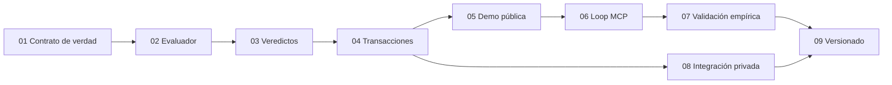

# Plan maestro — demostrar que `felix_felicis` funciona

El objetivo no es completar toda la visión antes de recibir evidencia. El
objetivo es demostrar, por capas, que Felix representa conocimiento sin
pérdida, detecta contradicciones formales, explica sus rechazos y mejora el
resultado de un agente en escenarios reproducibles.

## Estado global

| Campo | Valor |
|---|---|
| Estado | en curso |
| Versión de partida | `v0.1.0` |
| Próximo gate | `v0.2.0` |
| Progreso | 3/9 fases completas; fase 04 sigue en curso. U0–U4 y U6 están cerradas en sus límites; U5, U7 y U8 conservan avance parcial. Matriz local Windows+WSL y CI `38232932504` son históricas para `a082467`; CI `38240021138` pasó solo para `701de13`, `38242930608` para SHA `db71e3c` con el runner `RestoreOld` previo, y `38246129604` solo para `a4d01e5`; no hay CI verde del dispatcher final. |
| Foco actual | Fase 04, Unidad 7: journal, commit y recovery. U7 incluye `KeepOld` y `RestoreOld` acotadas. El preflight compartido se ejecuta una vez; el dispatcher crate-private solo enruta esas dos filas, sin caller desde apply/producción. No limpia stage ni ejecuta `DiscardNewRestoreOld`, validación de `New`, `Committed` o recovery completo. |
| Última actualización | 2026-10-12 |

Estados admitidos: `pendiente`, `en curso`, `bloqueado`, `completo`. Una fase
solo pasa a `completo` cuando cumple todos sus criterios de aceptación y deja
evidencia reproducible en su registro.

## Qué significa «funciona»

| Afirmación | Evidencia requerida |
|---|---|
| La representación es fiel | Carga, serialización y recarga conservan átomos y anexos. |
| El check es correcto | Un evaluador de referencia coincide con un corpus etiquetado y pruebas generativas. |
| El rechazo es explicable | Cada instancia falsa conserva un contraejemplo; `presence_core` y `gap` se emiten solo dentro de sus fragmentos acotados. |
| La operación es segura | Un candidato rechazado no modifica el universo persistido. |
| El sistema ayuda | Un agente con Felix mejora frente al mismo agente sin Felix en una evaluación pareada. |

## Ruta crítica

## Fases

| # | Fase | Estado | Depende de | Resultado observable |
|---|---|---|---|---|
| [01](01-contrato-de-verdad.md) | Contrato de verdad | completo | — | `validate` y `check` respetan contrato de comandos, códigos, canales, JSON v1 y privacidad; pruebas y CLI en `a9e1983`. |
| [02](02-evaluador-de-referencia.md) | Evaluador de referencia | completo | 01 | Parser, validación estática, expansión, Tarski, oráculo y `check` verificados; commits `2b5f721`–`a9e1983`. |
| [03](03-veredictos-explicables.md) | Veredictos explicables | completo | 02 | Criterios 01–17 cerrados con suites de `universo-core`/`universo-cli`; los conflictos funcionales del delta quedan asignados al gate de aceptación de fase 04. |
| [04](04-operacion-transaccional.md) | Operación transaccional | en curso | 03 | U0–U4 y U6 cerradas en sus límites; U5, U7 y U8 conservan avance parcial. U7 ejecuta solo `KeepOld` y `RestoreOld` tras un preflight inicial compartido; U8 añade captura CAS bajo lock, aún sin caller de apply/CLI. Cleanup de stage, `DiscardNewRestoreOld`, validación de `New`, `Committed`, recovery completo, U9–U10, `Type`, publicación filesystem y CLI siguen pendientes. |
| [05](05-demo-publica.md) | Demo pública | pendiente | 01–04 | Una contradicción y su reparación se reproducen con un comando. |
| [06](06-loop-de-agentes-mcp.md) | Loop de agentes por MCP | pendiente | 05 | Un agente propone, recibe veredicto, corrige y readmite. |
| [07](07-validacion-empirica.md) | Validación empírica | pendiente | 05–06 | Hay mediciones públicas de corrección, utilidad y costo. |
| [08](08-integracion-privada.md) | Integración privada | pendiente | 04 | El bundle real valida el motor sin filtrarse al repositorio público. |
| [09](09-versionado-y-evidencia.md) | Versionado y evidencia | pendiente | 07–08 | Cada tag corresponde a capacidades demostradas y CI verde. |

## Reglas de progreso

- Cada fase se implementa en una rama `codex/<fase>` o equivalente.
- Cada cambio conserva pruebas y documentación junto al comportamiento.
- Ninguna casilla se marca por intención; se marca con un commit, prueba o
  artefacto enlazado en el registro de evidencia.
- Un bloqueo explica qué falta, quién puede resolverlo y qué trabajo puede
  continuar sin esa decisión.
- Las mediciones se publican aunque contradigan la hipótesis del proyecto.
- Revisión AGM, recuperación avanzada y DPO/SqPO quedan fuera hasta que la
  demo mínima pruebe valor.

## Checklist maestro

- [x] 01 — El contrato estructural de `validate` y la aceptación semántica de `check` están implementados y verificados conjuntamente.
- [x] 02 — El evaluador de referencia ejecuta todo el AST soportado, con pruebas por variante, oráculo y límites de recursos documentados.
- [x] 03 — Los veredictos explican contradicciones y vacíos dentro de fragmentos acotados, con privacidad y presupuesto verificados.
- [ ] 04 — Las propuestas son transaccionales.
- [ ] 05 — La demo pública corre en CI.
- [ ] 06 — El loop MCP funciona de extremo a extremo.
- [ ] 07 — La evaluación comparativa tiene resultados publicados.
- [ ] 08 — La integración privada pasa sin exponer datos.
- [ ] 09 — Se publica el tag correspondiente con evidencia enlazada.

## Próximo paso

Foco actual: avanzar con la Unidad 7 de [04 — Operación transaccional](04-operacion-transaccional.md), journal, commit y recovery. Un preflight compartido inicial alimenta el dispatcher crate-private, que solo enruta `KeepOld` y `RestoreOld`; aún no hay caller desde apply/producción. `RestoreOld` solo acepta root `Absent`, backup `Old`, stage `Absent` y `root_new_validated=false` en `Prepared`/`BackupReady`/`Installed`. No limpia stage, ejecuta `DiscardNewRestoreOld`, valida `New`, maneja `Committed` ni completa recovery. U5 permanece parcial. U6 aporta root anclado y staging; U8 suma un helper crate-private de CAS bajo lock, pero captura y staging aún no están conectados a apply. Escritura filesystem y publicación siguen pendientes. El límite de evaluación sigue siendo por fórmula, sin cota agregada por propuesta, y requiere hardening antes de prometer un costo total.
La fase 03 preserva el baseline JSON v1; solo la salida solicitada usa v2.
El presupuesto medido de 1.000.000 se aplica al pase explicativo separado, no
al trabajo total del proceso. No se exponen asignaciones universales sensibles
ni resultados parciales por agotamiento de recurso.

## Evidencia de las fases cerradas

| Commit | Hito verificado |
|---|---|
| `2b5f721d66bef62e753b2481df8c7865da130d38` | Parser de cero o más sentencias con ubicaciones de fuente. |
| `602120977c3b0949730efd7a926c113879afb42c` | Validación estática tipada de invariantes. |
| `0b3df1162368c0cf1f5adbf4cc577897f146f1fa` | Evaluador Tarski y oráculo independiente con pruebas generativas. |
| `b8786dbc56bcf63a72fe540bf65ee6975484a861` | Expansión determinista de esquemas con límite de instancias. |
| `a9e198347ea40835b3686a16a349150fcbb7ff3c` | CLI `check`, JSON v1, canales y compatibilidad de `validate`. |

## Evidencia de fase 03 (fase completada)

| Commit / estado | Hito |
|---|---|
| `1a923bc` | Conteos medidos de evaluación/evidencia para trazas. |
| `5f28991` | Agregación de contraejemplos con selección `decide`/`enumerate`. |
| `cf0f752` | Extracción de cores de presencia subconjunto-minimales en fragmento operacional. |
| `df06f11` | Gap positivo integrado en el núcleo. |
| `4d8b238` | CLI `--explain` opt-in, JSON v2 y texto redactado. |
| `fd637ce5e82e17f6d75713cd0ce59f5a9e83af2d` | Casos límite de presencia/gap, replay semántico y forma positiva recursiva. |
| `ccd54b5ac1fd68178faca48389d3de2313054c6d` | Errores presupuestarios v2 sin parciales, orden `decide` y procedencia exacta. |

Verificación de fase 02 registrada: `cargo test -p universo-core` (108 unitarias y 7 de
integración); `cargo test -p universo-cli` (8 pruebas de `check` y 14 de CLI);
clippy en ambos crates, `cargo fmt --all -- --check` y los dos ejemplos
públicos pasan. Límites: 32 niveles, 64 ligaduras por cuantificador,
100.000 instancias expandidas y 1.000.000 de unidades deterministas de
evaluación; no constituyen SLA de latencia o memoria. La fase 03 tiene un
presupuesto explicativo global de 1.000.000 de unidades dentro del pase opt-in,
separado del check baseline y no representativo del límite total del proceso.
Verificación final de fase 03 en HEAD `ccd54b5`: `cargo test --workspace`
pasó 251 pruebas y 0 fallos. En detalle, `cargo test -p universo-core` pasó
(151 unitarias y 7 complementarias); `cargo test -p universo-cli` pasó
(1 unitaria, 8 `check`, 14 CLI y 12 explicación). Clippy, `cargo fmt --all
-- --check`, `python tools/check_public_boundary.py` y `git diff --check`
también pasan. El checklist de 17 criterios está completo, incluida la
asignación explícita de conflictos funcionales de delta al gate de aceptación
de fase 04; no afirma que fase 04 ya esté implementada. La explicación opt-in revela estructura lógica
abstracta y valores booleanos por instancia, ordinales/posiciones de fuente,
conteos derivados y métricas deterministas. Errores v2 redactan paths y
locations; errores legacy v1 conservan paths por compatibilidad. Un error de
presupuesto de explicación devuelve status `error` y summary nulo.

## Evidencia de fase 04 (en curso)

| Commit | Alcance | Evidencia |
|---|---|---|
| `1074902ec4687af435f2772de77febd161a59e68` | Modelo typed y canonicalizador core | 240 líneas añadidas; `delta_transaccional` pasa 6 casos focalizados, incluidos deduplicación y rechazo de `Ext` con predicados reservados. |
| `a54688ca274fa46f1a6a438df7988c13ef1176de` | Parser y serializador JSON v1 en OKF | 247 líneas añadidas; `delta_json_v1` pasa 5 casos focalizados, incluidos rechazo de duplicados y cargas 1/100/10.000. |
| `2a49aed5c0c957e87abced7d0db0a2cd6c3d1677` | Candidato aislado y retiro de aristas | 364 añadidas/1 borrada (365 authored); `candidato_delta` pasa 3/3. |
| `19d60627d0b2483a2dc5f266ceb360554f2781be` | Pruebas de retiro en lote | 203 líneas añadidas; `delta_aristas` pasa 5/5. |
| `f42cdb929d45ffac95350cbefbc59d5d8ff042fc` | Aislamiento y rechazo fail-closed | 170 añadidas/18 borradas (188 authored). |
| `9afb46405d8285259bfa621d570ae4c58cc893db` | Altas `Edge`/`HasLab` de arista | 166 añadidas/8 borradas (174 authored). |
| `fa710d474ab8abc22f0779437d283b6ad12331c6` | Casos de altas, no-op, grupos y mezcla remove/add | 253 líneas añadidas; `delta_aristas` alcanza 14 casos. |
| `826b3816f5b257707664567ebbee39ffe3be9d35` | Reemplazo de etiqueta por identidad final | 274 añadidas/24 borradas (298 authored); `delta_aristas` 14/14. |
| `00c6b9690570de33e4853a78998127eb9b10ac38` | Aplicación transaccional de `Ext` | 342 añadidas/18 borradas (360 authored); `ext_transaccional` 10/10. |
| `1e7aa65aa641c80a0ad0ab9fed2eb7ccd4cb81d4` | Roundtrips transaccionales de `Ext` | 165 añadidas/2 borradas (167 authored); `ext_roundtrip` 3/3. |
| `3b148913dee4af1d3cbfcbc7ae5dbf7769361833` | Clasificación de retiros `Ext` | 182 añadidas/24 borradas (206 authored). |
| `59dc0dd23fca6da6ced96f06de709a7b66489e49` | Runtime release de construcción de candidatos | 213 líneas; dos muestras únicas por escenario. Ext 2,900/3,113 ms; Edge 1/100/10.000: 0,014/0,016; 0,032/0,027; 1,912/1,736 ms. Conteos y bytes canónicos comunes en [04](04-operacion-transaccional.md). |
| `52234caf2dd8811094a379fc8184d4e228b43ee3` | Detector de conflictos funcionales sobre estado final | 149 añadidas/1 borrada (150 authored/churn). |
| `b5c027a16006133fc5dec7dec583928b192b9005` | Cobertura del detector | 342 líneas añadidas (342 authored/churn). |
| `86f16d3a95d3f9622eebc9eabf4ce9aa8bcb096c` | Normalización de etiquetas Edge | 229 añadidas/42 borradas (271 authored/churn). |
| `ec29ea6985907fcc6992e47753325e7fec8d5d45` | Agregación por identidad final | 211 añadidas/74 borradas (285 authored/churn). |
| `875915ca82fbc1449c731734711f0203a0521e83` | Casos límite y redacción | 321 añadidas/1 borrada (322 authored/churn); `conflictos_delta` 13/13. |
| `dfc359f9a2339b14cedd6c16c35a550446746461` | Ajuste de métricas runtime | 3 añadidas/3 borradas (6 authored/churn). Dos muestras de 1.000 conflictos: 10,512 ms / 95.132 conflictos/s y 13,315 ms / 75.101 conflictos/s. |
| `64206882d7cee4c5c9262c056e9edb54270cbdba` | Construcción core de `Parent` y `HasLab` nodo | 310 añadidas/50 borradas (360 authored/churn). |
| `9ccf8b3d51a018dacf6034c5dc87d884d091a3d7` | Pruebas de `Parent`/`HasLab` nodo | 374 líneas añadidas (374 authored/churn). |
| `d382fd5b4037b899ba6969aaae2bca5aa185a9b2` | Simplificación de validación | 1 añadida/3 borradas (4 authored/churn). |
| `3d40561fe717ba9f0e10349eead1e1639457dbf7` | Aserciones de transacción `Parent`/nodo | 112 añadidas/23 borradas (135 authored/churn). |
| `7d50be550bd093e24b89be710c6d79f05171da9a` | Orden de comprobación de ciclos `Parent` | 7 añadidas/12 borradas (19 authored/churn). |
| `595f0e2bf6fece6db319305890804f6245b03d43` | Clasificación técnica y preflight de propuesta | 243 añadidas/44 borradas (287 authored/churn); `proponer_preflight` 4/4. |
| `e6b4f60f2d623d60445396969d9150d1f61e311b` | API core `proponer` | 223 añadidas/1 borrada (224 authored/churn). |
| `15ed4b83af1c25883c83910cd60333f47c2c6748` | Pruebas de propuesta y privacidad | 373 líneas añadidas (373 authored/churn). |
| `9607a9a8191bbba3ae334178f5a61147359dc48e` | Clasificación técnica de `HasLab` incompleto | 49 añadidas/22 borradas (71 authored/churn). |
| `12bcc314918a4b4738b582475a3e0b1d33ed5469` | Precedencia técnica y casos `HasLab` | 185 añadidas/37 borradas (222 authored/churn). |
| `eb497cc2e60db1dd9e2df7397797855d142ce663` | Privacidad y agregación de `proponer` | 91 añadidas/7 borradas (98 authored/churn). |
| `010ffaf976e8366f9f724989201b5f9cff488bec` | Añade opt-in `layout.parent_key` y carga configurada de `Parent`. |
| `a79075172ce1a48e000eadfddde7a86cf56705ca` | Cubre carga de `Parent` explícito e inferido. |
| `9b6243172ea591e7577e56dcff31535917030eb5` | Valida la gramática de `parent_key`. |
| `b6dbf17467b97175c4380ad3f05208c7883f2b08` | Añade roundtrip de frontmatter `Parent` explícito. |
| `0ac65d8a7f48d1f7f1376c777c3e3ae2db785ed5` | Valida serialización en memoria de candidatos y overrides `Parent`. |
| `7dc774726fe1ef89e06110af067cc2d2c37bff6e` | Cubre casos límite del serializador de candidatos `Parent`. |
| `27289a9a14d5fba8bc0e7b61726e58069bf5bd39` | Añade runtime harness; 1.791 ms en `serializar_candidato` para 1.000 cambios. |

El JSON v1 tiene la forma exacta
`{"schema":"felix-delta-v1","add":[...],"remove":[...]}`. La API typed
canonicaliza y deduplica repeticiones; el parser JSON rechaza duplicados en las
listas, claves ausentes/desconocidas y claves duplicadas. Los casos focalizados
también prueban colisiones con los predicados reservados `Type`, `Edge`,
`Parent` y `HasLab`.

Esta Unidad 0 quedó completada en dos commits revisables, ambos bajo 400 líneas
y sin cambio de alcance; sus pruebas focalizadas fueron 6 de core y 5 de OKF.
La Unidad 1 quedó completada como construcción aislada de candidatos para
`Edge`/`HasLab` de arista y `Ext`. En HEAD `59dc0dd` pasan
`candidato_delta` 3/3, `delta_aristas` 14/14, `ext_transaccional` 10/10,
`ext_roundtrip` 3/3, `cargo test --workspace`,
`cargo clippy --workspace --all-targets -- -D warnings`,
`cargo fmt --all -- --check` y `python tools/check_public_boundary.py`.
Después de editar los planes pasan también enlaces Markdown locales y
`git diff --check`. El runtime tiene dos muestras únicas por escenario; la
variación observada es orientativa, sin warmup, distribución estadística ni
SLA. Los bytes informados son strings canónicos UTF-8, no heap ni bundle; los
valores completos están en [04 — Operación transaccional](04-operacion-transaccional.md).

Unidad 2 quedó cerrada en core. En HEAD `eb497cc` pasan
`nodo_parent_transaccional` 13/13, `conflictos_delta` 13/13,
`proponer_preflight` 4/4 y `proponer_transaccional` 10/10; workspace, clippy,
fmt y frontera pública también pasan, y los enlaces locales y diff pasan tras
editar los planes. La propuesta pura separa error técnico, conflicto funcional
y rechazo por invariantes; expande/evalúa sobre el candidato y redacta la
procedencia. `Parent` y `HasLab` de nodo se construyen en core. Unidad 3 añade
carga y serialización en memoria de `Parent` con `layout.parent_key`; no escribe
archivos ni publica cambios. `Type` sigue técnico/unsupported en `proponer`
y solo tiene detector standalone; los conflictos `Ext` siguen técnicos según
Unidad 1. La incidencia v1 no es representable.

El runtime del detector ya registrado usa 1.000 conflictos (334/333/333), 3
clases resumen y dos muestras únicas orientativas; confirma
`snapshot_unchanged=true` sin emitir hashes. El presupuesto de evaluación es
por fórmula, no una cota agregada por propuesta: hardening y medición global
siguen pendientes, sin promesa de costo total. Todos los commits de los dos
slices recientes se mantuvieron bajo 400 líneas authored/churn.

Fase 04 sigue en curso y el progreso maestro permanece en 3/9. Unidad 3 queda
cerrada en carga y serialización en memoria de `Parent`; el harness release
anterior midió 1.791 ms para 1.000 cambios y overrides, sin medir escritura ni
publicación filesystem.

Unidad 4 queda cerrada como primitiva interna. En HEAD `2475dc3` (mismo conteo
de pruebas que `61b22fd`) la verificación integrada registra workspace
377 passed/5 ignored, snapshot focal 2/2 y captura 8/8 más 1 harness ignorado;
clippy, fmt y frontera pública pasan. La captura lee una vez a buffers raw,
incluye archivos y directorios vacíos, y compara el token antes de parsear; el
token es opaco y `to_hex()` explícito. No hay apply, escritura ni publicación.
El runtime de captura y su comando reproducible están en el registro de [04](04-operacion-transaccional.md).

Unidad 5 tiene avance parcial, no está cerrada. El harness release de locks
registró en una muestra: 2 writers, 5 busy/7 intentos (71,4%) y espera máxima
54,842 ms; 8 writers, 92 busy/100 (92,0%) y espera máxima 363,207 ms. El máximo
de intervalos marcados fue 1 en ambos escenarios; el marcador no cubre la vida
completa del guard. `LockEscritura` serializa escritores Felix cooperantes; no
excluye un proceso externo hostil que modifique el filesystem.

Unidad 6 queda cerrada para root anclado y staging. El harness privado real
`crates/universo-okf/src/transaccion/stage/stage_bundle_transaccional.rs`
midió 10.000 auxiliares y 104.857.600 bytes en 51.158,840 ms (2,050 MB/s;
1,955 MiB/s). Es una muestra orientativa, sin SLA; el tiempo cubre el pipeline
completo de `materializar_staging_anclado`: crear/escribir staging,
recargar/inventariar el bundle, validar el candidato recargado y emitir el
recibo. Excluye captura, planificación y construcción del candidato. El
rollback limpia el sibling y confirma token e identidad de root intactos.
Pruebas de aliases, recarga y cleanup acompañan al harness. El test Windows
`junction_root_se_rechaza_sin_seguirla` confirma el root reparse y canary
externo intacto cuando falla la adquisición del lock, antes de staging; la
ausencia observada de un sibling es una guarda de efectos laterales, no prueba
de que se haya llamado al materializador. El test focal, workspace, clippy,
fmt y frontera pública pasan en HEAD `cddc3e3`.

U6 no conecta lock, captura ni staging a apply. U7 conserva avance parcial:
además de las filas `KeepOld` y `RestoreOld`, suma un preflight compartido
inicial y un dispatcher crate-private que solo las enruta. `RestoreOld` acepta
solo root `Absent`, backup `Old`, stage `Absent` y `root_new_validated=false`
en `Prepared`/`BackupReady`/`Installed`. Aún no hay caller desde apply/producción.
No limpia stage ni ejecuta `DiscardNewRestoreOld`; `New`, `Committed` y el resto
de recovery siguen pendientes. U8 añade un helper crate-private que abre root
desde `lock.ubicacion()` y delega al CAS anclado (`aa5d496`); las pruebas
`8250f0d` cubren match/stale/lock/no mutación y `08e4659` mapea y redacta el
error de root inválido. No hay caller apply/CLI, parser de `SnapshotToken` de
entrada ni semántica de recaptura de configuración raw externa. Apply/publicador
filesystem y cleanup/restart completos, U9–U10, CLI y soporte transaccional de
`Type` siguen pendientes. El presupuesto agregado de evaluación aún no tiene
cota global.
